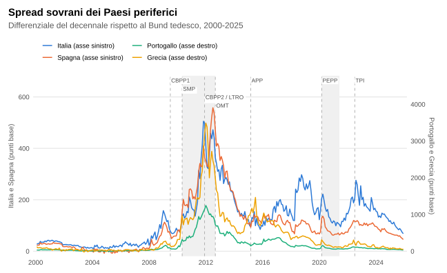
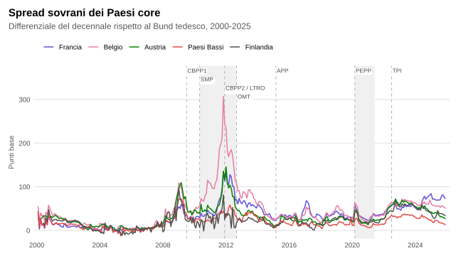
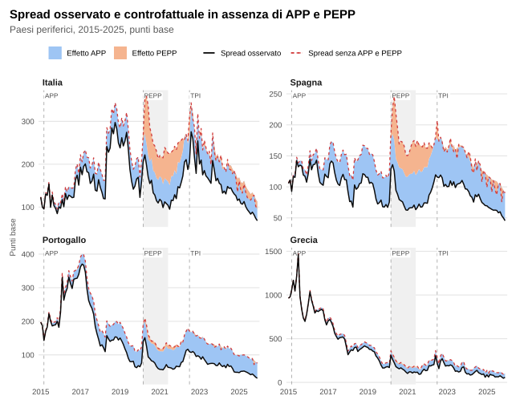

# Sovereign spread drivers in the Euro Area (2000–2025)

Raffaele De Simone · Sapienza University of Rome · developed during an internship at the Italian Ministry of Economy and Finance (MEF)

---

This repository presents the R code and the main charts of my analysis of the drivers of euro area sovereign spreads: which factors explain the spread of each country over Germany, how their weight has changed across market phases, and how much ECB policy has helped to compress spreads.

I estimate a country fixed-effects panel on 9 euro area countries (Italy, Spain, Portugal, Greece, France, Belgium, Austria, Netherlands, Finland) from January 2000 to April 2025. The dependent variable is the 10-year government bond spread over the German Bund. The explanatory variables are:

- **market and macro**: relative industrial production vs. Germany, real effective exchange rate, VIX, bid-ask spread;
- **fiscal policy**: debt-to-GDP and budget balance differentials vs. Germany, excessive deficit procedure;
- **ECB monetary policy**: deposit facility rate; first-generation measures, i.e. the Covered Bond Purchase Programmes (CBPP1, CBPP2) and the 3-year Longer-Term Refinancing Operations (LTRO); the stock of the Asset Purchase Programme (APP); monthly purchases by country under the Pandemic Emergency Purchase Programme (PEPP).

The model is estimated on the full sample and on three market phases (2000–07, 2008–19, 2020–25). As a robustness check for the COVID shock, it is re-estimated excluding 2020.

Finally, for the peripheral countries (Italy, Spain, Portugal, Greece) I estimate what spreads would have been without the APP and the PEPP. The gap between observed and counterfactual spreads measures how much each programme compressed them.

## Charts







*ECB instruments in the charts: CBPP1/CBPP2 – Covered Bond Purchase Programmes; SMP – Securities Markets Programme; LTRO – Longer-Term Refinancing Operations; OMT – Outright Monetary Transactions; APP – Asset Purchase Programme; PEPP – Pandemic Emergency Purchase Programme; TPI – Transmission Protection Instrument.*

## Results

Dependent variable: 10-year sovereign spread vs. Germany, basis points. Robust standard errors in parentheses. \*, \*\*, \*\*\* = significant at 10%, 5%, 1%; ns = not significant.

### Table 1 — Full sample, time windows and robustness excluding 2020

| Variable | Full 2000–25 | 2000–07 | 2008–19 | 2020–25 | Full excl. 2020 | 2021–25 |
|---|---|---|---|---|---|---|
| **Fundamentals** | | | | | | |
| IP | −3.06\*\*\* (0.244) | −0.53 ns (0.383) | −9.90\*\*\* (0.860) | +0.25 ns (0.169) | −2.85\*\*\* (0.251) | +0.505\* (0.268) |
| REER | +6.75\*\*\* (0.677) | −0.47 ns (0.718) | +16.73\*\*\* (1.752) | −0.82 ns (0.667) | +7.12\*\*\* (0.685) | +1.09 ns (0.837) |
| VIX | +1.09\*\*\* (0.288) | +0.52\* (0.274) | +2.46\*\*\* (0.513) | +1.75\*\*\* (0.141) | +1.54\*\*\* (0.312) | +2.03\*\*\* (0.263) |
| BID_ASK | +7.37\*\*\* (0.113) | +8.82\*\*\* (3.111) | +6.01\*\*\* (0.138) | +6.94\*\*\* (0.975) | +7.31\*\*\* (0.113) | +4.34\*\*\* (1.283) |
| **Fiscal policy** | | | | | | |
| DEBT_DIFF | +1.99\*\*\* (0.234) | +0.25 ns (0.333) | +0.85\*\*\* (0.134) | +0.71\*\*\* (0.167) | +2.52\*\*\* (0.246) | −0.090 ns (0.223) |
| OB_DIFF | −10.67\*\*\* (0.960) | +0.67 ns (0.490) | −7.05\*\*\* (0.292) | −4.37\*\*\* (0.944) | −10.32\*\*\* (0.977) | −6.63\*\*\* (1.068) |
| EDP | +43.23\*\*\* (15.477) | +1.15 ns (11.01) | +38.56\* (20.31) | +15.24 ns (10.039) | +40.38\*\*\* (15.546) | +18.96\* (9.679) |
| **Monetary policy** | | | | | | |
| DF_liv | −1.13 ns (2.000) | +9.76\*\*\* (2.392) | −4.30\*\*\* (1.451) | +7.74\*\*\* (0.814) | −2.03 ns (2.044) | +7.50\*\*\* (1.058) |
| QE1 | −0.341\*\* (0.146) | not active | −0.63\*\*\* (0.230) | not active | −0.299\* (0.165) | not active |
| APP | −0.0176\*\*\* (0.0027) | not active | −0.0125\*\* (0.0058) | +0.0449\*\*\* (0.0043) | −0.0194\*\*\* (0.0028) | +0.0595\*\*\* (0.0063) |
| PEPP | −4.20\*\*\* (1.267) | not active | not active | −5.41\*\* (2.436) | −4.62\*\* (1.89) | −5.42\*\*\* (0.405) |
| **R²** | 0.726 | 0.150 | 0.758 | 0.523 | 0.733 | 0.533 |
| **Observations** | 2,712 | 840 | 1,296 | 576 | 2,604 | 468 |

### Table 2 — Counterfactual: spread compression due to APP and PEPP (basis points)

| Country | Date | Observed | APP effect | PEPP effect | Total effect | Counterfactual |
|---|---|---|---|---|---|---|
| Italy | Jun 2020 | 169.9 | 51.0 | 116.0 | 167.0 | 336.9 |
|  | End 2021 | 147.5 | 57.8 | 44.1 | 101.9 | 249.4 |
|  | Jun 2022 | 187.7 | 60.5 | 7.4 | 67.8 | 255.5 |
| Spain | Jun 2020 | 94.5 | 51.0 | 72.4 | 123.4 | 217.9 |
|  | End 2021 | 74.2 | 57.8 | 30.8 | 88.6 | 162.9 |
|  | Jun 2022 | 119.5 | 60.5 | 1.4 | 61.9 | 181.4 |
| Portugal | Jun 2020 | 94.0 | 51.0 | 14.2 | 65.2 | 159.2 |
|  | End 2021 | 65.2 | 57.8 | 2.6 | 60.5 | 125.7 |
|  | Jun 2022 | 116.8 | 60.5 | 2.3 | 62.7 | 179.5 |
| Greece | Jun 2020 | 180.3 | 51.0 | 16.8 | 67.8 | 248.2 |
|  | End 2021 | 134.0 | 57.8 | 4.3 | 62.2 | 196.2 |
|  | Jun 2022 | 304.9 | 60.5 | −1.7 | 58.8 | 363.7 |

## Code

```
├── run_all.R                     runs the whole analysis in order
└── R/
    ├── 01_dati_e_panel.R         data loading and panel construction
    ├── 02_modello_completo.R     fixed-effects model, 2000–2025
    ├── 03_finestre_temporali.R   2000–07, 2008–19, 2020–25 windows
    ├── 04_robustezza_no2020.R    re-estimation excluding 2020
    ├── 05_controfattuale.R       spreads without APP and PEPP
    └── 06_grafici.R              charts (ggplot2), saved to figure/
```

## Contact

Raffaele De Simone
